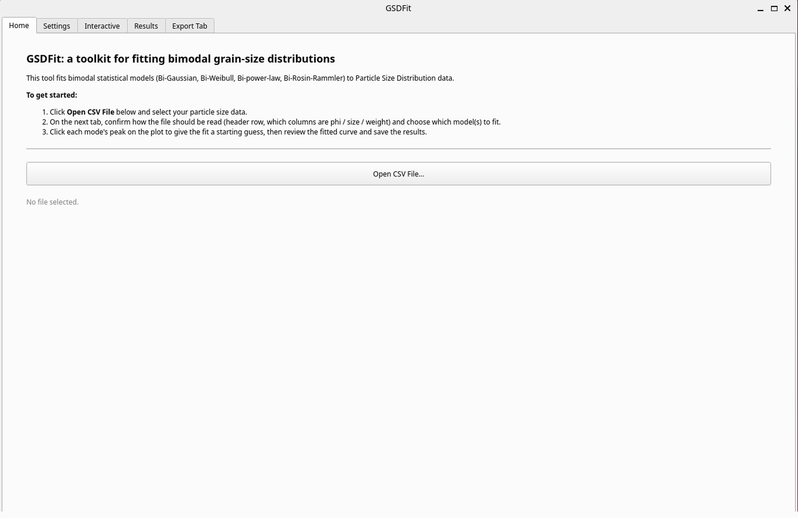
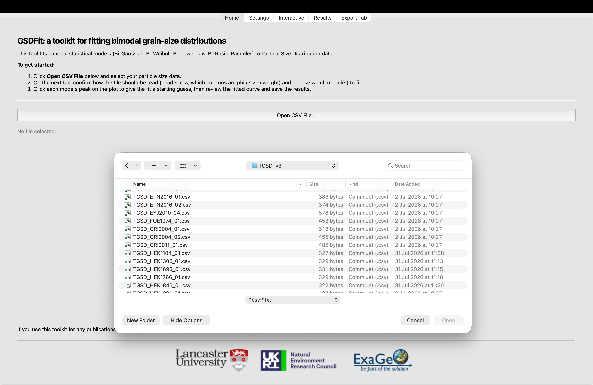
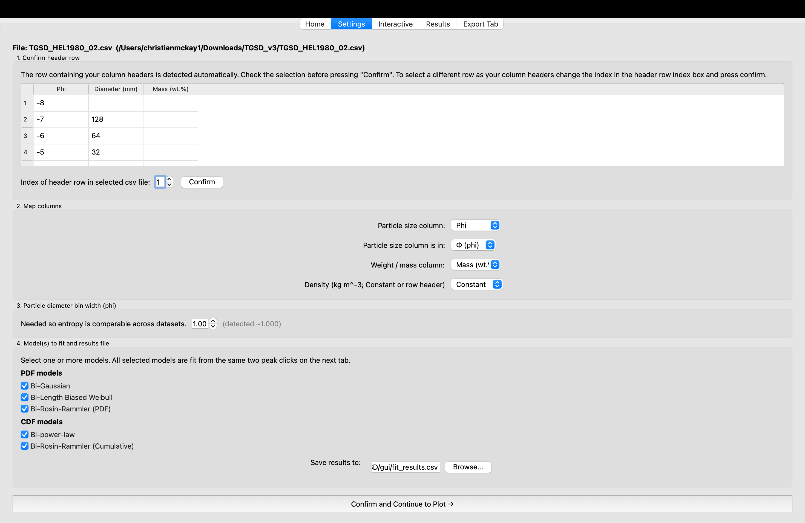
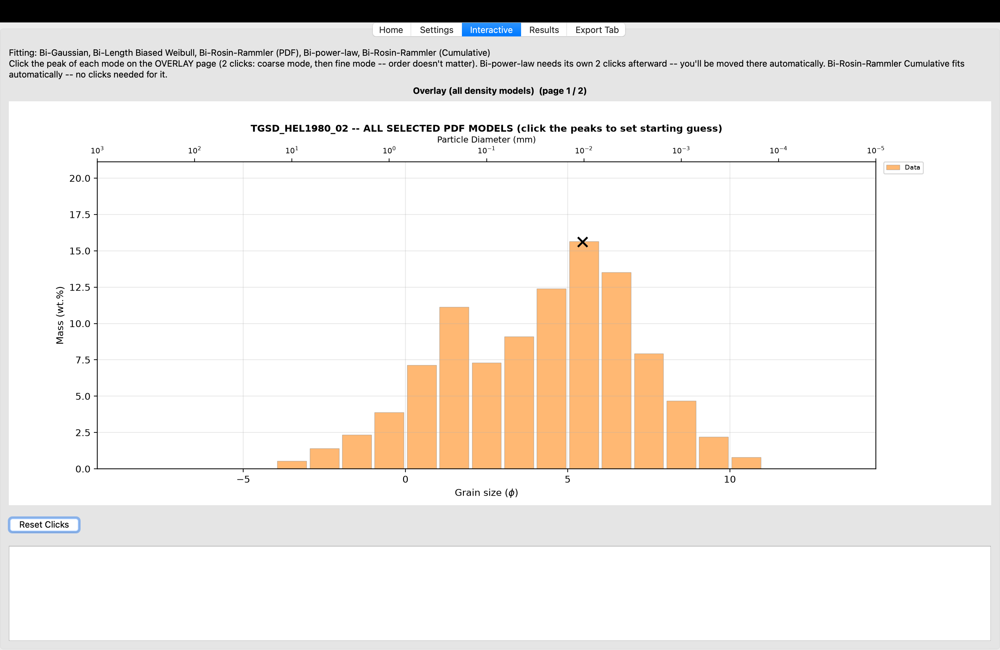
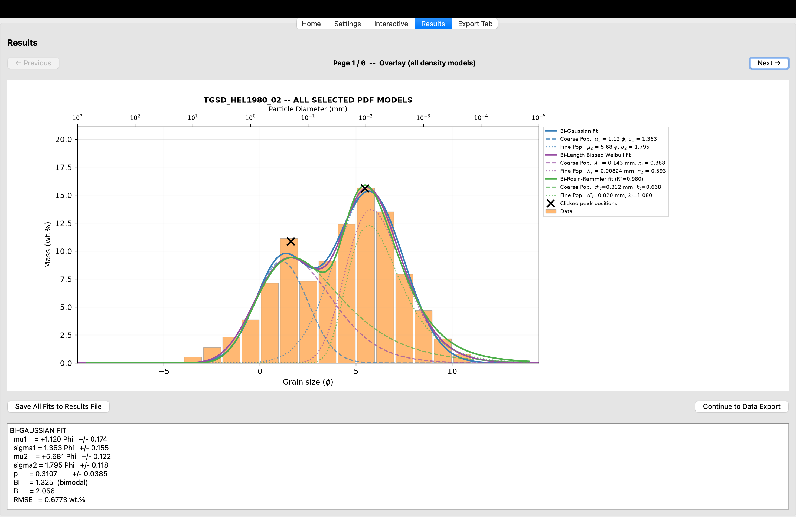
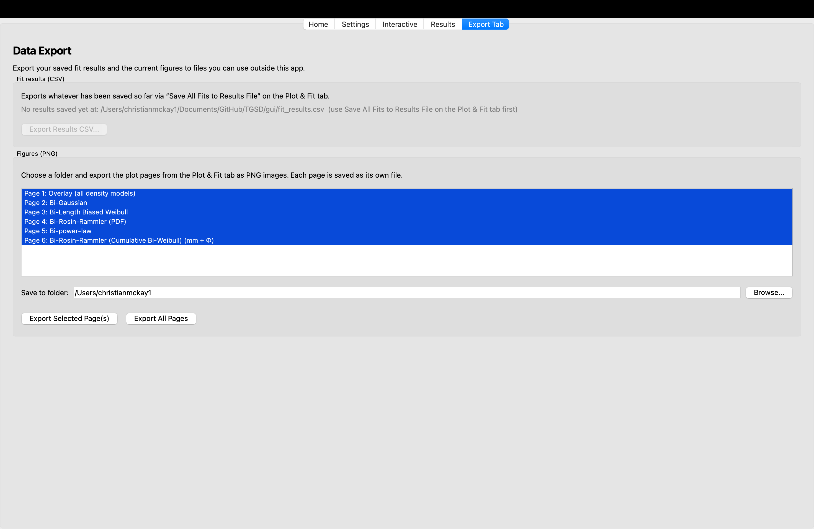

# GSDFit

**Grain-Size Distribution Fitting Tools**

GSDFit is a desktop application for fitting and comparing bimodal statistical models to Total Grain Size Distribution (TGSD) data from volcanic ash and other grain-size samples. It accepts weight percent versus phi grain-size data and fits four bimodal models:

- **Bi-Gaussian**
- **Bi-Weibull**
- **Bi-Rosin-Rammler**
- **Bi-power-law**

The PyQt6 interface guides users through loading CSV files, confirming column mappings and bin width, selecting initial peak positions on the plot, reviewing fitted curves, and exporting parameters and figures.

## Download GSDFit for Windows

> [!IMPORTANT]
> **Windows users:** Download and run the pre-built installer—no Python or development environment is required.

**[Download the latest Windows installer](https://github.com/christian051105/Particle-Size-Distributions/releases/latest)**

## Installing GSDFit as a Python package on Windows, Linux, and macOS

The source code can be installed as a Python package using the following environment managers. We recommend the use of Pixi.

- **Pixi** — creates and activates the `gsdfit` Pixi environment
- **Conda** — creates and activates the `gsdfit` Conda environment
- **pip** — creates a Python virtual environment and installs the project package

This repository includes `pixi.toml` for Pixi, `environment.yml` for Conda, and `requirements.txt` for pip.

## Clone the repository

Clone the repository once, then enter the project directory:

```bash
git clone https://github.com/christian051105/Particle-Size-Distributions.git
cd Particle-Size-Distributions
```
## Create the environment

### with Pixi 

Install the Pixi environment and this project as an editable Python package:

```bash
pixi run install
```


### with Conda

Create the environment from `environment.yml`, activate it, and install this project as an editable Python package:

```bash
conda env create -f environment.yml
conda activate gsdfit
python -m pip install -e .
```

To update an existing Conda environment instead:

```bash
conda env update -n gsdfit -f environment.yml --prune
conda activate gsdfit
python -m pip install -e .
```

### with pip

Create and activate a Python virtual environment, install the dependencies, and install this project as an editable package:

```bash
python -m venv .venv
source .venv/bin/activate
python -m pip install --upgrade pip
python -m pip install -r requirements.txt
python -m pip install -e .
```

Run pip commands from inside this project directory.

## Launch the GUI

### Pixi

First activate the Pixi environment from the Particle-Size-Distribution directory:

```bash
pixi shell
```
Then with the Pixi shell activated:

```bash
gsdfit-gui
```
or 
```bash
python -m gsdfit
```

Or without activating the shell:

```bash
pixi run gui
```


### Conda root

Make sure the Conda environment is activated:

```bash
conda activate gsdfit
```
Then:
```bash
gsdfit-gui
```

Or launch the GUI directly:

```bash
python -m gsdfit
```

### pip

With the virtual environment activated:

```bash
gsdfit-gui
```

Or launch the GUI directly:

```bash
python -m gsdfit
```
## Usage

<table width="100%" style="table-layout: fixed;" border="1" rules="cols" cellpadding="16">
  <tr>
    <td width="45%" valign="middle"><strong>1. Launch GSDFit.</strong><br><br>Start the application using the desktop launcher or the command-line instructions above. The home page provides the entry point for loading and fitting particle-size distribution data.</td>
    <td width="55%" align="right" valign="middle"></td>
  </tr>
</table>

<br>

<table width="100%" style="table-layout: fixed;" border="1" rules="cols" cellpadding="16">
  <tr>
    <td width="45%" valign="middle"><strong>2. Load the data.</strong><br><br>Click <strong>Open CSV File...</strong> on the home page and select one or more grain-size distribution CSV files. A physical size column in millimetres or micrometres is only required when fitting the bi-power-law model.</td>
    <td width="55%" align="right" valign="middle"></td>
  </tr>
</table>

<br>

<table width="100%" style="table-layout: fixed;" border="1" rules="cols" cellpadding="16">
  <tr>
    <td width="45%" valign="middle"><strong>3. Confirm and configure the fit.</strong><br><br>On the settings tab, confirm the CSV header row and map the phi, size, and weight columns. Specify the size unit if supplied, or indicate that it is already in phi units. Confirm or adjust the phi bin width, choose one or more models, and select the destination for the results CSV.</td>
    <td width="55%" align="right" valign="middle"></td>
  </tr>
</table>

<br>

<table width="100%" style="table-layout: fixed;" border="1" rules="cols" cellpadding="16">
  <tr>
    <td width="45%" valign="middle"><strong>4. Add starting guesses.</strong><br><br>For density models, left-click once at the peak of each mode on the combined overlay page; the order does not matter. If bi-power-law is selected, complete its separate two-click phase on the cumulative number-distribution page. The plot pages navigate automatically, and <strong>Reset Clicks</strong> restarts the current selection.</td>
    <td width="55%" align="right" valign="middle"></td>
  </tr>
</table>

<br>

<table width="100%" style="table-layout: fixed;" border="1" rules="cols" cellpadding="16">
  <tr>
    <td width="45%" valign="middle"><strong>5. Review the fitted models.</strong><br><br>When fitting completes, GSDFit displays the generated curves page by page. Use the <strong>Previous</strong> and <strong>Next</strong> buttons to inspect each fitted model and its parameters. Every phi-based page also includes a secondary millimetre scale.</td>
    <td width="55%" align="right" valign="middle"></td>
  </tr>
</table>

<br>

<table width="100%" style="table-layout: fixed;" border="1" rules="cols" cellpadding="16">
  <tr>
    <td width="45%" valign="middle"><strong>6. Save and export the results.</strong><br><br>Use <strong>Save All Fits to Results File</strong> to store the current fitted parameters in the results CSV. From the data export tab, export fit results and selected or all generated plot pages as PNG images. Exported plot names include the dataset name, page number, and page title.</td>
    <td width="55%" align="right" valign="middle"></td>
  </tr>
</table>

## Data format

CSVs should contain, at minimum:

- A **phi** column containing grain-size bins on the phi/Φ scale.
- A **weight or mass** column containing weight percent or raw mass. Raw mass values are normalized internally to sum to 100%.
- An optional **size** column in millimetres, micrometres, or phi units. A size column is required only for the bi-power-law model.

Fitted results are stored in a results CSV as stacked per-model blocks, rather than as one wide table, because each model uses a different parameter set.

## Notes

- Confirm the phi bin width on the settings tab. Entropy comparisons are only meaningful across datasets with the same bin spacing, or after accounting for differences in bin spacing.
- Bin widths are commonly detected and snapped to values such as 0.25, 0.5, 1.0, or 2.0 Φ.
- The phi values used internally represent bin centres, calculated as phi_edge - bin_width / 2. For a default bin width of 1.0 Φ, this subtracts 0.5.
- Use **Reset Clicks** if a fitting starting guess needs to be selected again.

## Building a Windows Distribution
Windows installers are built automatically via github actions when a new version is released. They can also be built manually by following the instructions below. 

### Requirements

The Windows build environment is provided by `gsdfit-dev.yml` and contains:

- Python >=3.14.6,<3.15
- PyQt6 >=6.11.0,<7
- pandas >=3.0.5,<4
- SciPy >=1.18.0,<2
- Matplotlib >=3.11.1,<4
- NumPy >=2.5.1,<3
- pip
- PyInstaller
- Make

You will also need Conda or Miniconda/Miniforge, Git and [Inno Setup](https://jrsoftware.org/inno-setup).

### Create and activate the development environment

From the repository root in a Windows terminal:

```bash
conda env create -f gsdfit-dev.yml
conda activate gsdfit-dev
python -m pip install -e .
```

If the environment already exists, update it instead:

```bash
conda env update -n gsdfit-dev -f gsdfit-dev.yml --prune
conda activate gsdfit-dev
python -m pip install -e .
```

Verify the build tools and package dependencies:

```bash
python --version
pyinstaller --version
make --version
python -c "import PyQt6, pandas, scipy, matplotlib, numpy; print('Build dependencies available')"
```

### Build the distribution

With `gsdfit-dev` activated, run this command from the repository root:

```bash
make build
```

The provided Makefile removes an existing `dist/gsdfit` directory and uses `gsdfit.spec` to build the application with PyInstaller.

The distributable is written to:

```text
dist/gsdfit/
```

To remove generated build files:

```bash
make clean
```

### Build the Windows installer

After building `dist/gsdfit`, install [Inno Setup](https://jrsoftware.org/isinfo.php). The installer script is `gsdfit.iss`, and the resulting setup executable is written to `dist/`.

To compile the installer with the fallback version defined in `gsdfit.iss`, open a Command Prompt or PowerShell window in the repository root and run:

```powershell
& "${env:ProgramFiles(x86)}\Inno Setup 6\ISCC.exe" gsdfit.iss
```

To use a specific release version, pass it as `MyAppVersion`:

```powershell
& "${env:ProgramFiles(x86)}\Inno Setup 6\ISCC.exe" /DMyAppVersion=1.2.3 gsdfit.iss
```

For example, version `1.2.3` creates:

```text
dist/GSDFit-1.2.3-Setup.exe
```

## Acknowledgements

Developed with support from Lancaster University, UKRI NERC, and ExaGeo.

---

<table width="100%" style="table-layout: fixed;">
  <tr>
    <td align="center" valign="middle"></td>
    <td align="center" valign="middle"></td>
    <td align="center" valign="middle"></td>
  </tr>
</table>